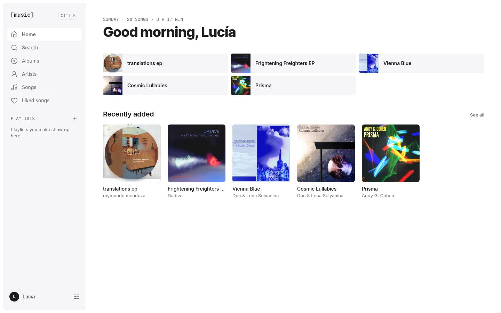
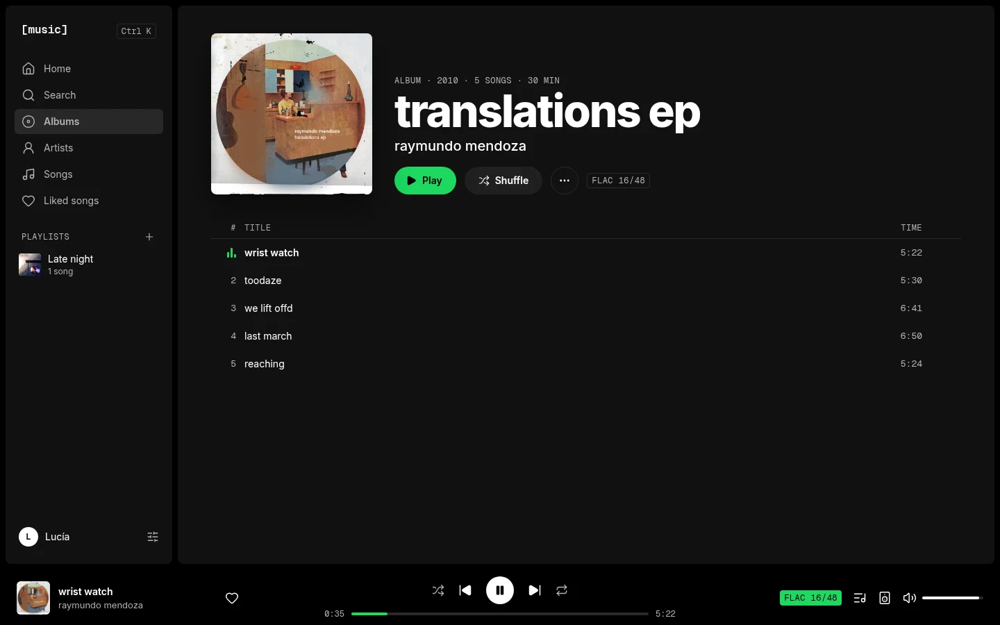
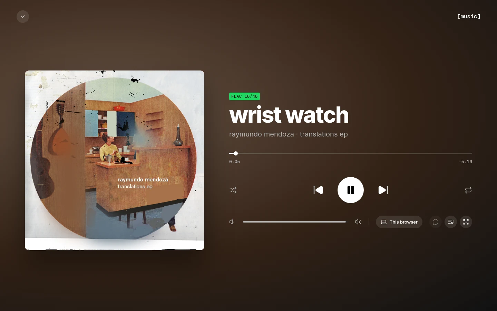
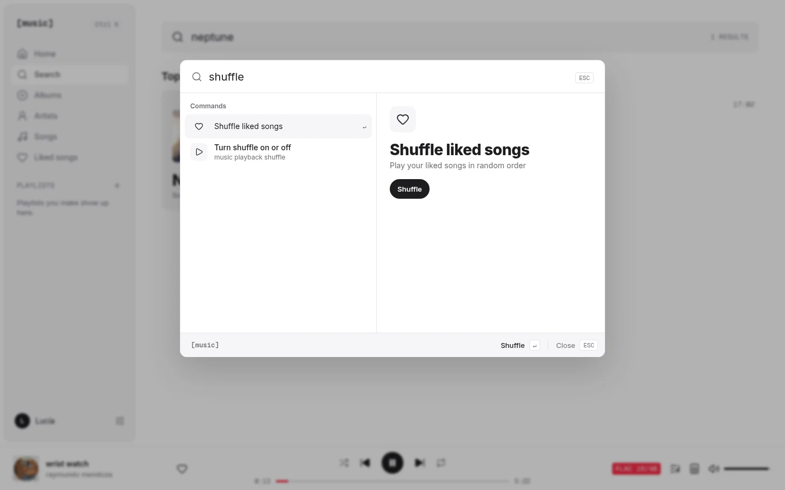
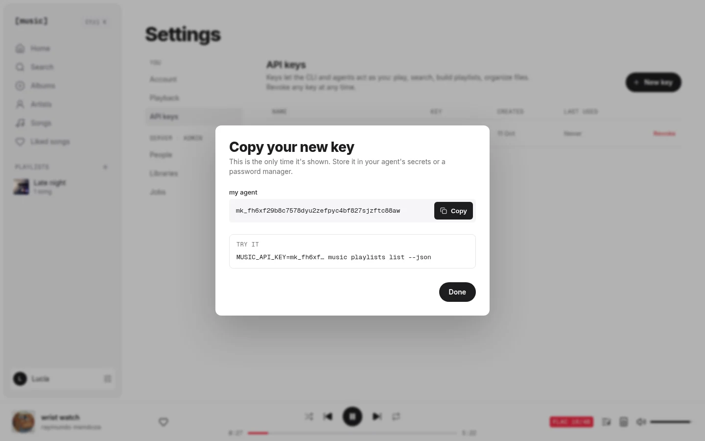
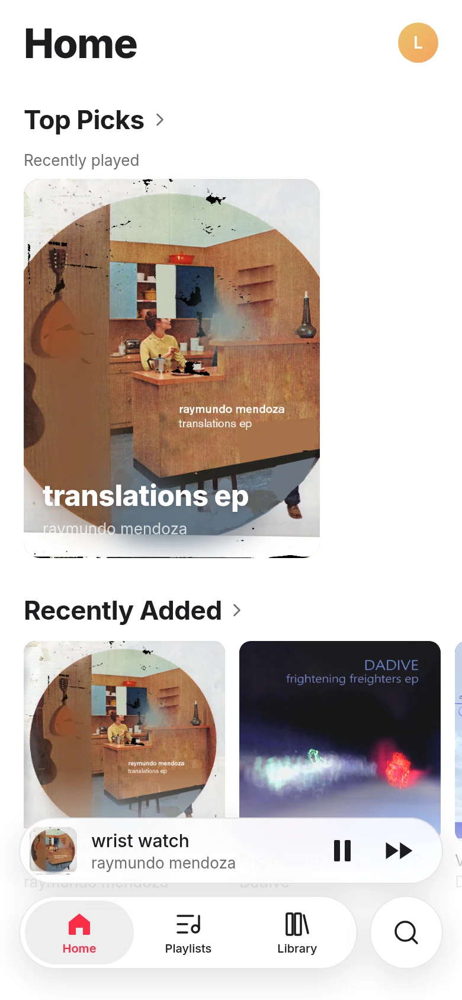
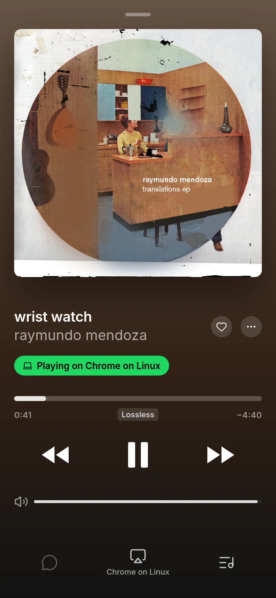

# [music]

Self-hosted music for people and agents. Stream your own library from one install, with
multi-user accounts, live handoff between devices, lossless and gapless playback, and a CLI that
can do everything the app can.



|                                                            |                                                      |
| ---------------------------------------------------------- | ---------------------------------------------------- |
|  |  |
|      |         |

<p>
  
  
</p>

A one-minute walkthrough recording is attached to the
[latest release](https://github.com/lmdevv/music/releases).

## What it does

- **Your files, your tags.** Point it at folders in the usual Artist/Album layout. It reads the
  existing tags and artwork, watches for changes, and never rewrites your files.
- **Lossless and gapless.** FLAC plays as FLAC. Albums play without gaps through a Media Source
  Extensions engine that trims encoder delay to the sample; browsers without it fall back to
  regular audio. Lower-quality AAC streams for slow connections.
- **Every device, one session.** Start on your laptop, move to your phone, control either from
  the other. The queue, position, likes, playlists, and history follow you.
- **Multi-user.** The first account is the admin. Invite others with a link; libraries can be
  shared or private.
- **Agent-first.** Every action is a command in one registry. The web app's command menu (⌘K),
  the `music` CLI, and the agent skill in [`skills/music`](skills/music/SKILL.md) all run the
  same commands. API keys let agents act for you.
- **One install.** A single container (or a NixOS module) runs everything on one port.

## Install

```sh
docker run -d --name music -p 8080:8080 \
  -v music-data:/data \
  -v /path/to/your/music:/music:ro \
  -e PUBLIC_URL=http://localhost:8080 \
  ghcr.io/lmdevv/music:main
```

Open <http://localhost:8080>, create the admin account, and add `/music` as a library. The first
scan starts at once; albums appear while it runs.

- **Compose:** [`deploy/docker/compose.yaml`](deploy/docker/compose.yaml).
- **NixOS:** import the flake's `nixosModules.default` and set
  `services.music = { enable = true; musicDirs = [ "/srv/music" ]; };`.
- **Remote access:** put it behind your own reverse proxy or Tailscale and set `PUBLIC_URL`.
- **Images:** `linux/amd64` and `linux/arm64`.
- **Data:** everything lives in `/data`: the database, artwork, the transcode cache, generated
  secrets, and a backup taken before every upgrade.
- **Try it with free music:** [`docs/demo-music.md`](docs/demo-music.md) downloads five Creative
  Commons albums.

## CLI and agents

Create an API key in Settings → API keys, then:

```sh
pnpm --filter @music/cli build && alias music="node $PWD/apps/cli/dist/music.js"
music login --server http://localhost:8080/convex --key mk_...
music play cosmic lullabies
music playlists create "Late night" --track-ids "$(music search neptune --json | jq -r '[.tracks[].id] | join(",")')"
music libraries scan <library-id> --wait
music commands --json        # every command with its arguments as JSON Schema
```

Give an agent [`skills/music/SKILL.md`](skills/music/SKILL.md) and an API key. There is no MCP
server; the CLI is the interface.

## How it works

| Part                                       | Role                                                                     |
| ------------------------------------------ | ------------------------------------------------------------------------ |
| [Convex](https://convex.dev) (self-hosted) | All product state, auth, live sync, and the job queue                    |
| `apps/media` (Node, Hono, Effect, ffmpeg)  | Scans and watches folders, serves signed streams and artwork, transcodes |
| `apps/web` (Vite, React, TanStack Router)  | The web app, designed in Paper, light and dark, desktop and phone        |
| `packages/player`                          | Gapless MSE engine, HTML audio fallback, device sync                     |
| `apps/cli` + `skills/music`                | The CLI generated from the command registry, and the agent skill         |
| `packages/commands`                        | Every user action as an Effect Schema, shared by all of the above        |
| Caddy + s6                                 | One port: `/` web app, `/convex` API and WebSocket, `/media` streams     |

Convex is the only source of truth for product state. The media service is the only process that
touches files, and it never decides access: Convex signs each stream URL after checking the user
can read that library.

## Development

```sh
nix develop                    # Node 24, pnpm, ffmpeg, Caddy
pnpm install
scripts/dev-backend.sh         # self-hosted Convex in Docker on :3210, deployed and configured
pnpm dev                       # web on :3001, media service, Convex watcher
```

Checks: `pnpm typecheck`, `pnpm lint`, `pnpm fmt:check`, `pnpm test`, `pnpm knip`, and the
real-stack end-to-end suite `scripts/stack-e2e.sh`, which builds the image and drives the real app
with real audio. See [`AGENTS.md`](AGENTS.md) for the layout and rules.

## Status

The MVP is complete: server, web app, CLI, and agent skill. Native iOS, Android, and desktop
apps, offline downloads, lyrics, and plugins come next.

## License

MIT. The bundled Convex backend is FSL-1.1, converting to Apache-2.0 after two years. Demo music
credits are in [`docs/demo-music.md`](docs/demo-music.md).
